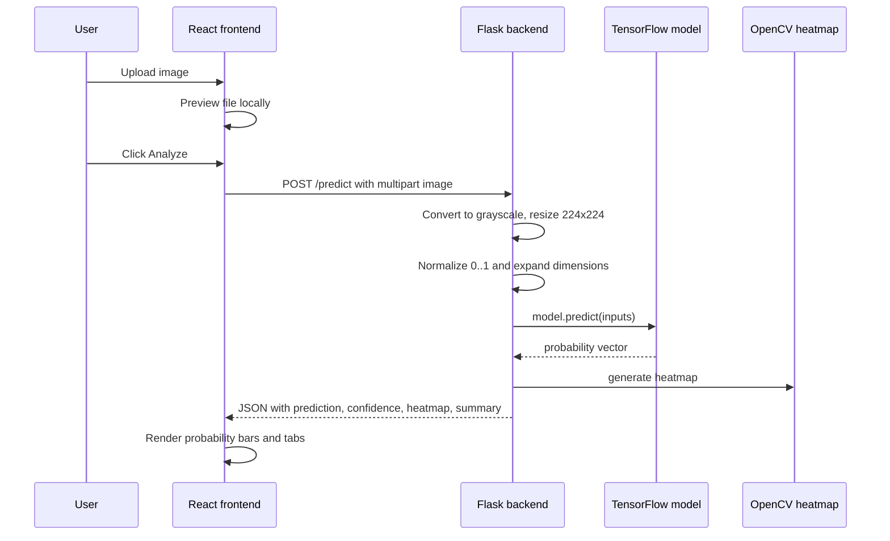

# Project Audit

## Executive summary

This repository is a minimal proof-of-concept diagnostic dashboard with a Flask backend, a TensorFlow/Keras inference model, and a Vite/React frontend. The code shows a clear single-image classification workflow, but the project is not complete as a reproducible or production-ready major-project implementation. The most important issue is that the trained model file is absent, which prevents full inference testing.

## Repository structure

### Root-level files

Verified root entries include:

- [README.md](README.md)
- [backend](backend)
- [frontend](frontend)
- [test.jpg](test.jpg)
- [test1.jpeg](test1.jpeg)
- [test3.png](test3.png)
- [.gitignore](.gitignore)
- [.idea](.idea)

### Backend

- [backend/app.py](backend/app.py)
- [backend/requirements.txt](backend/requirements.txt)

### Frontend

- [frontend/index.html](frontend/index.html)
- [frontend/package.json](frontend/package.json)
- [frontend/src/main.jsx](frontend/src/main.jsx)
- [frontend/src/App.jsx](frontend/src/App.jsx)
- [frontend/src/styles.css](frontend/src/styles.css)
- [frontend/src/components/ImageUpload.jsx](frontend/src/components/ImageUpload.jsx)
- [frontend/src/components/ResultPanel.jsx](frontend/src/components/ResultPanel.jsx)
- [frontend/src/components/ProgressBar.jsx](frontend/src/components/ProgressBar.jsx)
- [frontend/src/components/ResultPanel.jsx.bak](frontend/src/components/ResultPanel.jsx.bak)

## Major findings

### 1. Model artifact is missing

The backend expects `model_multiclass_v1.h5` at the project root, but no `.h5` file is present. This means the model cannot be loaded in the current workspace.

### 2. Training pipeline is absent

No training script, dataset loader, or evaluation notebook was found. This means the project cannot be traced end-to-end from data acquisition to model training.

### 3. Documentation and implementation are inconsistent

The README describes a file named `xray_model.h5`, while the backend loads `model_multiclass_v1.h5`.

### 4. Frontend logic does not fully match the backend class design

The backend predicts among `COVID`, `Normal`, `Pneumonia`, and `Tuberculosis`, but the frontend result panel contains logic based on a binary `Abnormal` label. This is a mismatch between the current code and the likely intended UX logic.

### 5. There are signs of abandoned work

- [frontend/src/components/ResultPanel.jsx.bak](frontend/src/components/ResultPanel.jsx.bak) indicates a backup or stale version of the component.
- The repo has no dataset or model outputs committed.

## Architecture reconstruction

### Workflow

### Actual responsibilities

- Frontend: file upload, preview, API call, rendering
- Backend: image preprocessing, inference, heatmap generation, result packaging
- Model: expected CNN classifier over four classes
- OpenCV: custom heatmap visualization

## Dependency and environment audit

### Python dependencies

From [backend/requirements.txt](backend/requirements.txt):

- flask
- tensorflow
- opencv-python
- numpy
- pillow
- flask-cors

### Frontend dependencies

From [frontend/package.json](frontend/package.json):

- React 18.2.0
- React DOM 18.2.0
- Vite 5.0.0

### Environment variables and external services

No secret-bearing configuration was found in the repository. There are no `.env` files in the workspace and no external API integration was identified. The app is fully local in its current implementation.

## Reproducibility assessment

The repository does not currently provide a verified run environment because:

- the trained H5 model is missing
- the Python dependencies are not validated in this environment
- the model file naming is inconsistent with repository documentation

As a result, the project is not currently reproducible in a strict sense without additional model and dependency recovery work.

## Improvement opportunities for a major project

### 1. Multimodal learning

What needs to change:

- Add structured clinical feature support alongside X-ray images
- Add patient symptom and blood-test feature models
- Combine image and tabular inputs at a fusion layer

Reusable files:

- backend app route can be expanded
- frontend upload can include patient metadata fields
- existing result panel can be extended to present combined predictions

New dependencies:

- pandas
- scikit-learn
- possibly a tabular model layer or multimodal library

Complexity: moderate to high

Technical difficulty: moderate

Achievability in ~1 month: possible for a simple late-fusion prototype, not for a production-grade multimodal pipeline

### 2. Explainable AI

What needs to change:

- Replace the handcrafted heatmap with Grad-CAM or another model-based explainability approach
- For structured data, add SHAP-based feature attribution

Reusable files:

- the backend prediction pipeline can be extended
- the frontend result display can present explanation overlays and feature importance

New dependencies:

- tensorflow-addons or Grad-CAM library
- shap

Complexity: moderate

Technical difficulty: moderate

Achievability in ~1 month: yes, for a limited prototype

### 3. Model evaluation

What needs to change:

- Add a proper evaluation pipeline
- Compare baseline vs improved model variants
- Report class-wise metrics and confusion matrices

Reusable files:

- none currently exist for training/evaluation

New dependencies:

- scikit-learn
- matplotlib
- seaborn

Complexity: moderate

Technical difficulty: low to moderate

Achievability in ~1 month: yes, if a dataset is recovered

### 4. Uncertainty estimation

What needs to change:

- Add calibration and confidence estimation
- Use MC-dropout, ensemble predictions, or temperature scaling
- Surface reliability indicators to the frontend

Reusable files:

- backend prediction contract can be extended
- frontend result panel can display reliability badges

New dependencies:

- uncertainty or calibration toolkits
- optionally a deeper ensemble approach

Complexity: moderate to high

Technical difficulty: moderate

Achievability in ~1 month: yes for simple confidence calibration, less so for robust Bayesian-style uncertainty estimation

### 5. Diagnostic report improvements

What needs to change:

- Add structured report summaries
- Include probability table, explanation, and caution message
- Add patient- and case-level metadata inputs

Reusable files:

- result panel and summary text logic can be expanded
- backend response shape can grow without breaking the current UI

New dependencies:

- none required for a basic report

Complexity: low to moderate

Technical difficulty: low

Achievability in ~1 month: high

## Priority recommendation

For a major project, the highest-value next steps are:

1. Recover or regenerate the model artifact and verify the training/evaluation environment.
2. Add a standard evaluation pipeline with class metrics and confusion matrices.
3. Implement a real explainability method such as Grad-CAM.
4. Add structured clinical metadata support only after the image-only model is stable.
5. Improve the frontend reporting layout to show uncertainty and explanation panels.

## Final assessment

The repository is a functioning prototype conceptually, but it is not yet a complete and reproducible research-grade project. The missing model file and lack of training artifacts are the main blockers. The current code provides a useful starting point for a major-project extension, but it needs model recovery and verification before deeper academic work can proceed.
